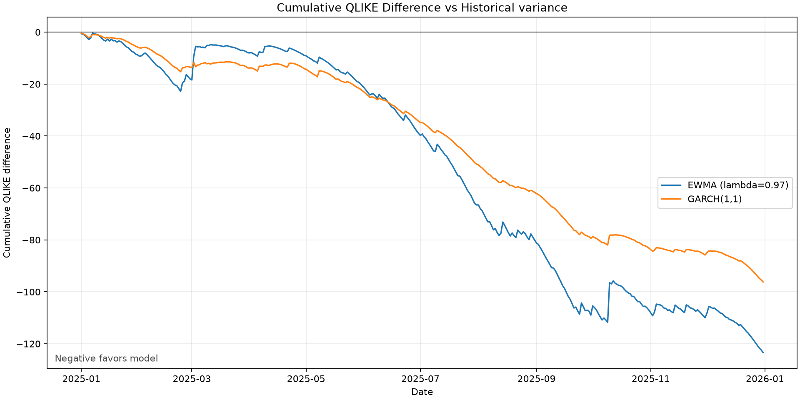

# Volatility Forecasting Research

This project compares one-day-ahead BTCUSDT variance forecasts from
persistence, expanding historical variance, EWMA, and GARCH(1,1). It uses
daily Binance Spot candles and evaluates forecasts against squared log
returns with QLIKE, MSE, and MAE.

## Main result

EWMA with validation-selected lambda 0.97 had the lowest 2025 test QLIKE,
MSE, and MAE. Its QLIKE advantage over GARCH(1,1) was not statistically
significant after Holm adjustment. Both models had significantly lower QLIKE
than expanding historical variance.

Negative values favor the candidate model. These findings are exploratory
because the 2025 test period was inspected during development. See the
[full results and limitations](docs/results.md).

## Quick start

Run these commands from the repository root in PowerShell.

~~~powershell
python -m venv .venv
.\.venv\Scripts\Activate.ps1
python -m pip install -r requirements.txt
~~~

Fetch a raw-data snapshot:

~~~powershell
python -m src.fetch_data --symbol BTCUSDT --interval 1d --start 2019-01-01 --end 2026-01-01
~~~

Then run the experiment from that snapshot:

~~~powershell
python -m src.pipeline --raw-path data/raw/btcusdt_1d_2019-01-01_2026-01-01.json
~~~

The pipeline validates the data, writes a processed CSV under
`data/processed/`, selects the EWMA decay on the validation period, and
prints validation and test metrics. It also writes a versioned result bundle
under `results/runs/`.

Generate tables and figures from one saved run without refitting any model:

~~~powershell
python -m src.generate_report --run-directory results/runs/<run_id>
~~~

The command writes an atomic report bundle under
`results/reports/<run_id>/` containing:

- `metric_summary.csv`
- `dm_summary.csv`
- `cumulative_qlike.csv`
- `volatility_forecasts.png`
- `cumulative_qlike.png`
- `report_metadata.json`

The cumulative QLIKE table retains every non-benchmark model. The default
figure compares the candidate models with `historical_variance` and omits
`persistence` from the plot only because its extreme QLIKE scale would hide
the candidate-model paths. Use `--benchmark` to select another benchmark.

## Data snapshots

Fetching data and running the experiment are separate commands. A normal
experiment run reads an existing snapshot and does not contact Binance or
modify the raw file.

The `--end` argument is exclusive, so `--end 2026-01-01` includes candles
through 2025-12-31.

The fetch command writes:

- `data/raw/btcusdt_1d_2019-01-01_2026-01-01.json`
- `data/raw/btcusdt_1d_2019-01-01_2026-01-01.metadata.json`

The metadata stores the request details, retrieval time, returned date range,
row count, and SHA-256 checksum. Existing snapshot or metadata files are not
overwritten. Raw and processed data are kept locally and excluded from Git.

Use `python -m src.fetch_data --help`, `python -m src.pipeline --help`, or
`python -m src.generate_report --help` to see the available arguments.

## Tests

~~~powershell
python -m pytest -q
~~~

Binance requests are mocked in the test suite, so tests do not download live
market data.

## Research protocol

The forecast definitions, model settings, data splits, and evaluation rules
are documented in the [research plan](docs/research_plan.md). Planned
implementation phases are listed in the
[implementation plan](docs/implementation_plan.md).

The 2025 test-period metrics were inspected during development, so current
2025 findings are exploratory rather than untouched confirmatory evidence.
See [protocol amendments](docs/amendments.md).

DM/HAC comparisons and Holm-adjusted results are saved in `dm_results.csv`.
Reporting reads the saved run artifacts and reproduces summary tables and
diagnostic figures without downloading data or refitting models.
