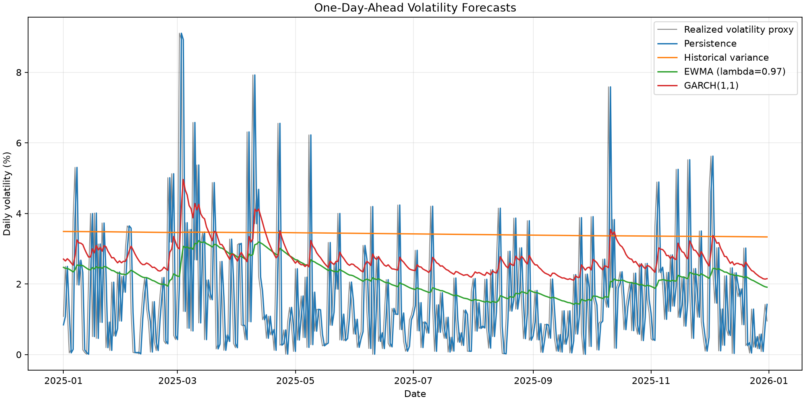
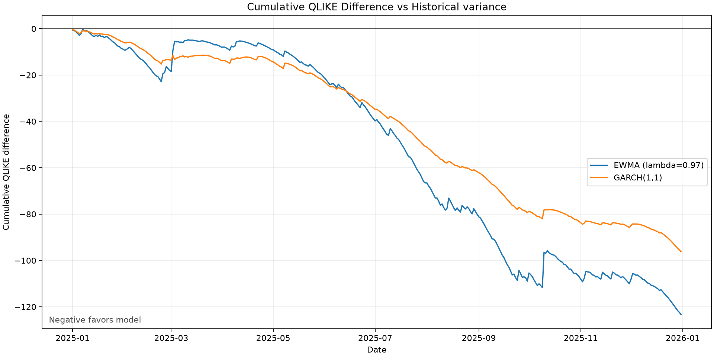

# Exploratory Results

## Scope and provenance

These results come from run `20261106T121313Z_6782d4c`, created from the
immutable BTCUSDT daily snapshot covering 2019-01-01 through 2025-12-31.
The snapshot SHA-256 is
`3bb6a337953d289d562d2060c95d56f74f9e39a2364cdada890af21f69d791da`.
The run records commit `6782d4c9afe1a9c145578ccf3cfc5c75da33c4ce` and a clean
working tree.

The 2025 test period had already been inspected during development. These
findings are therefore exploratory, not untouched confirmatory evidence, as
recorded in [the protocol amendments](amendments.md).

## Validation selection

EWMA decay was selected only among the four pre-specified EWMA candidates.
Lambda 0.97 had the lowest validation QLIKE, narrowly ahead of lambda 0.99.
GARCH was a fixed candidate model and was not part of this tuning decision.

| Model | Validation QLIKE | Validation MSE | Validation MAE |
|---|---:|---:|---:|
| EWMA, lambda 0.90 | -6.148172 | 2.264664e-6 | 0.000901 |
| EWMA, lambda 0.94 | -6.157974 | 2.246026e-6 | 0.000891 |
| EWMA, lambda 0.97 | **-6.158911** | **2.242973e-6** | 0.000900 |
| EWMA, lambda 0.99 | -6.158710 | 2.254165e-6 | 0.000956 |

## Test forecast performance

Lower values are better for all three losses. The ranking is based on 365
one-day-ahead forecasts in 2025.

| Model | QLIKE | QLIKE rank | MSE | MSE rank | MAE | MAE rank |
|---|---:|---:|---:|---:|---:|---:|
| EWMA, lambda 0.97 | **-6.687619** | 1 | **9.499495e-7** | 1 | **0.000543** | 1 |
| GARCH(1,1) | -6.613207 | 2 | 1.018244e-6 | 2 | 0.000704 | 3 |
| Expanding historical variance | -6.349592 | 3 | 1.438553e-6 | 3 | 0.001011 | 4 |
| Persistence | 556.134739 | 4 | 1.519911e-6 | 4 | 0.000637 | 2 |

Relative to expanding historical variance, EWMA reduced mean MSE by 33.96%
and mean MAE by 46.29%. GARCH reduced them by 29.22% and 30.33%,
respectively. A relative percentage is not reported for QLIKE because its
level is not invariant to additive normalization; the QLIKE loss difference
is reported instead.

Persistence produced an extreme mean QLIKE despite a less extreme MAE. Its
one-day lagged squared-return forecast can become very small, and QLIKE
penalizes a small variance forecast heavily when the next squared return is
large. This is a feature of the pre-specified loss and forecast, not a reason
to remove observations after seeing the result.

*Daily forecasts are displayed on the volatility scale for interpretation;
model estimation and evaluation remain on the variance scale.*

## Diebold-Mariano comparisons

The loss differential is QLIKE for model A minus QLIKE for model B, so a
negative mean favors model A. Raw p-values come from the individual DM tests.
Adjusted p-values control the family-wise error rate across the five
pre-specified comparisons using Holm's procedure.

| Model A | Model B | Mean difference | DM statistic | Raw p-value | Holm-adjusted p-value | Significant at 5% |
|---|---|---:|---:|---:|---:|:---:|
| GARCH(1,1) | EWMA(0.97) | 0.074412 | 1.4095 | 0.158682 | 0.248142 | No |
| GARCH(1,1) | Persistence | -562.747946 | -1.7349 | 0.082758 | 0.248142 | No |
| GARCH(1,1) | Historical variance | -0.263616 | -7.4794 | 7.4637e-14 | 3.7318e-13 | Yes |
| EWMA(0.97) | Persistence | -562.822358 | -1.7352 | 0.082714 | 0.248142 | No |
| EWMA(0.97) | Historical variance | -0.338028 | -4.1781 | 2.9392e-5 | 0.0001176 | Yes |

EWMA had lower average QLIKE than GARCH in this sample, but their difference
was not statistically significant after Holm adjustment. Both candidate
models had significantly lower QLIKE than expanding historical variance.
Neither comparison with persistence was significant after adjustment. The
large persistence mean differences coexist with high variability in the
daily loss differential, so the mean magnitude alone should not be described
as statistically conclusive.

*Negative cumulative differences favor the candidate model over expanding
historical variance. Persistence is omitted from this figure because its
extreme scale would obscure the candidate-model paths.*

## Answer to the research questions

The primary question asked whether Gaussian GARCH(1,1) achieved lower test
QLIKE than validation-selected EWMA. It did not: EWMA had the lower mean
QLIKE, MSE, and MAE. However, the DM/Holm result does not support a claim that
the expected QLIKE losses of EWMA and GARCH differ at the 5% family-wise
level.

For the secondary question, both EWMA and GARCH showed statistically
significant QLIKE improvements over expanding historical variance. The
pre-specified tests did not establish significance relative to persistence.
The appropriate conclusion is therefore narrower than saying that either
candidate dominates every benchmark.

## Numerical diagnostics and limitations

All 106 scheduled GARCH fits completed successfully: 53 in validation and 53
in test. Forecast evaluation used all 365 common test dates. These checks
support the numerical completeness of the run but do not remove the study's
main limitations:

- squared daily return is a noisy variance proxy rather than intraday realized variance;
- the sample contains one asset and one test year;
- the Gaussian zero-mean GARCH specification is deliberately narrow;
- the 2025 results are exploratory because the test period was exposed during development; and
- statistical non-rejection is not evidence that two models are equivalent.

A confirmatory follow-up requires a new unseen holdout period and a frozen
protocol before inspecting its outcomes.

## Reproduction

From the repository root, rebuild the report without refitting models:

~~~powershell
python -m src.generate_report --run-directory results/runs/20261106T121313Z_6782d4c
~~~

The source run and generated report directories are intentionally excluded
from Git because they are generated artifacts and may contain large files.
